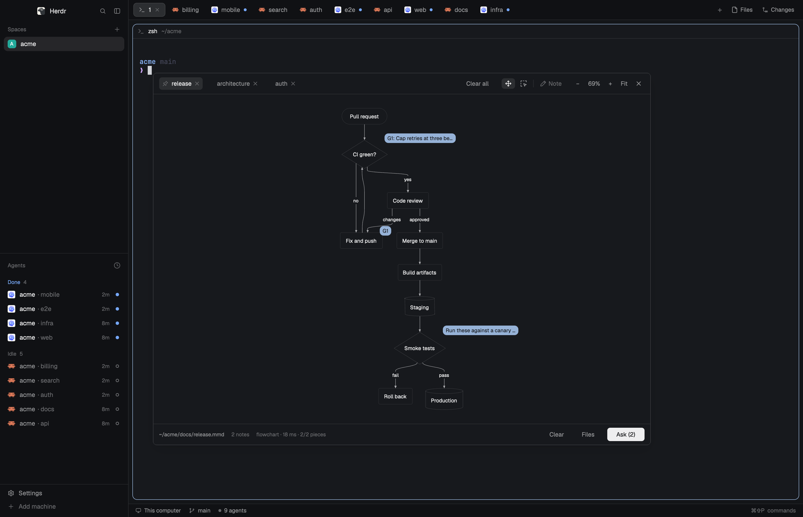
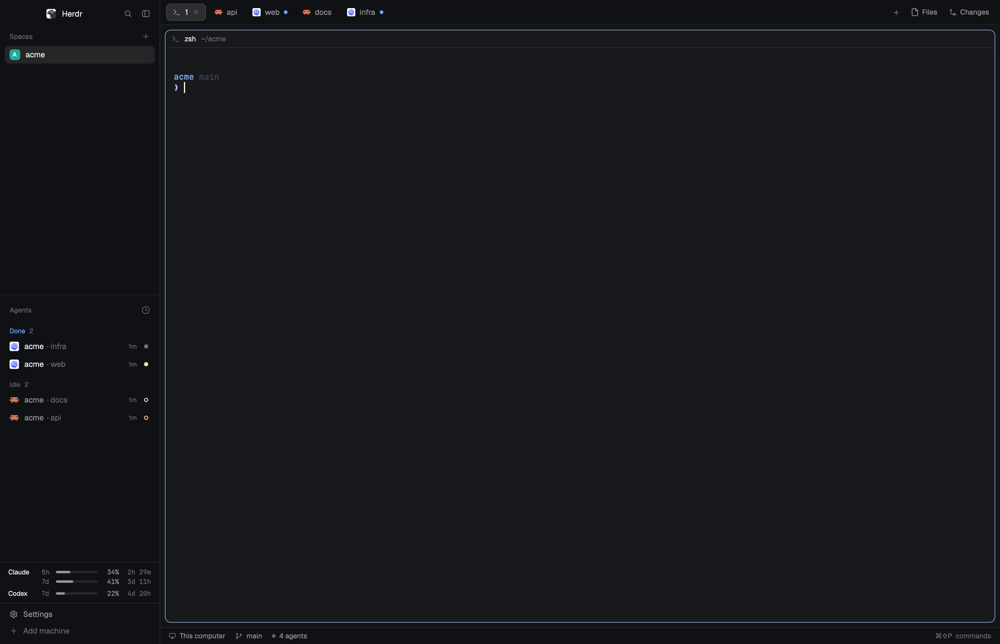
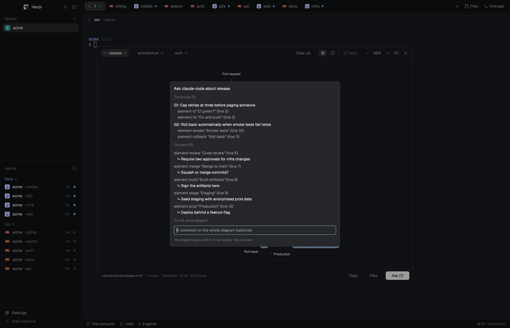
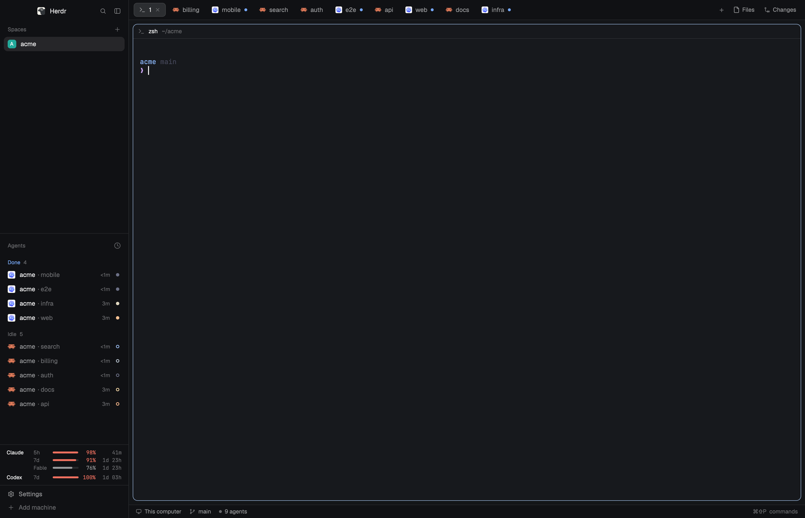

# hmods

- [herdr-mermaid](herdr-scene/RECIPE.md) opens the Mermaid diagrams in your
  repository in a Herdr window. You pick a node or an edge and write a note on
  it. Ask sends the notes to the tab's agent with the source lines they point
  at.
- [herdr-meter](herdr-meter/RECIPE.md) shows when each agent's prompt cache
  expires, on that agent's ring in the sidebar. It also shows how much of the
  Claude and Codex rate limits is left.

Each tool has a CLI that installs its mods: `hscene` for herdr-mermaid and
`hmeter` for herdr-meter.

| herdr-mermaid | herdr-meter |
| --- | --- |
|  |  |
|  |  |

## What install does

`hscene install` and `hmeter install` copy their mods into the Herdr app home
(`$HERDR_APP_HOME`, else `~/.config/herdr-app`; `--app-home DIR` picks
another) as real files, so Herdr draws their icons and an open mod reloads in
place. Each installed mod folder holds a `.hmods` marker naming its tool, and
`uninstall` removes only folders with its own marker. A folder already at the
target without that marker is first moved to
`${XDG_STATE_HOME:-~/.local/state}/hmods/backups/<UTC time>/`.
`--dry-run` prints the steps; `status` compares the installed and package
versions.

## Install without Nix

From the checkout, run the installer with Node.js 22.18 or newer. It uses
the committed renderer and icons. For a direct install from herdr.dev, copy
the share's `mods/mermaid/` folder into the app home's `mods/` directory.

```sh
node herdr-scene/cli/hscene.mjs install
```

Run `node herdr-scene/cli/hscene.mjs --skill` for the agent manual and its
topic list. A mod-only install from the share has no CLI commands or manual.
To use `check` and `parts` from the checkout, build the CLI as described
below and run `node herdr-scene/build/hscene.mjs`.

For the cache and usage mods, run these commands from the checkout:

```sh
cargo install --locked --path herdr-meter
hmeter install
```

## Install with Nix

```sh
nix run .#hscene -- install
nix run .#hscene -- status
```

To keep `hscene` on PATH, run `nix profile add .#hscene`. For a custom
Herdr app home, pass `--app-home DIR` to the installer. To include the agent
skill, ask the person for their skills directory, then run
`hscene install --skill DIR`. This installs `DIR/herdr-scene/SKILL.md`,
a pointer to the manual in the CLI. Read `hscene --skill` for Ask and
placement, `hscene --skill mermaid` for edits and checks, or
`hscene --skill pele-css` for styling.

Run `hscene status` to see recorded skill paths and versions. Later installs
refresh owned `herdr-scene` copies. Linked skills stay under their existing
manager.

For the cache and usage mods, install the package and run its installer:

```sh
nix profile add .#hmeter
hmeter install
```

The flake offers `https://cache.mulatta.io` as a binary cache; Nix asks
before using it unless you are a trusted user. It evaluates without
import-from-derivation.

### From another flake

Add the repository as an input and put the tools on PATH, for example with
home-manager:

```nix
{
  inputs.hmods.url = "github:mulatta/hmods";

  # in a home-manager module
  home.packages = with inputs.hmods.packages.${pkgs.stdenv.hostPlatform.system}; [
    hscene
    hmeter
  ];
}
```

The packages carry their mods, so nothing lands in the app home on switch.
After each switch that changes them, run `hscene install` and
`hmeter install`; open mods reload in place. Setting
`inputs.hmods.inputs.nixpkgs.follows` rebuilds both tools locally instead of
using the cache.

## Development

Each top folder is one tool, its mods and its herdr.dev share (`RECIPE.md`):

- `herdr-scene/`: the `hscene` CLI (`check`, `parts`, `install`, `--skill`),
  the `mermaid` mod with its committed renderer bundle, `keys.json` and the
  optional `herdr-scene` agent skill.
- `herdr-meter/`: the `hmeter` CLI (Rust) and the `cache` and `usage` mods it
  installs.
- `nix/`: how each is built; `flake.nix` only wires them up.

`nix develop` supplies Node.js, esbuild and the pinned pele source. From
the repository root, rebuild the share bundle and run the tests:

```sh
bash herdr-scene/scripts/build.sh
node --test herdr-scene/tests/*.test.mjs
nix build .#hscene .#checks.aarch64-darwin.vendor-fresh
nix fmt
```

Use the check for your system. Without Nix, the build script uses Git to
cache the pinned pele checkout and npx for the matching esbuild version.

## License

MIT, see [LICENSE](LICENSE). The mermaid mod bundles
[pele](https://github.com/obsidianmd/pele) (MIT); its notice ships in
`herdr-scene/mods/mermaid/NOTICE`.
