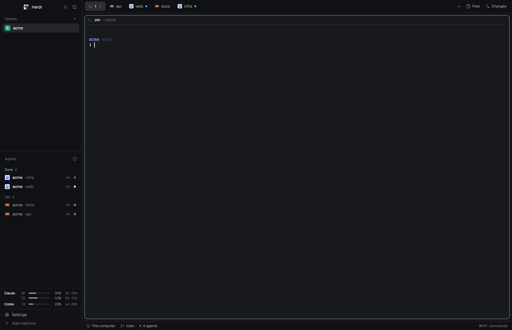
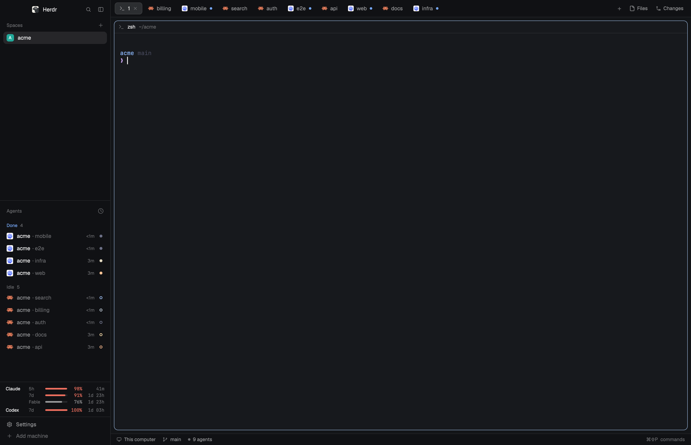

# herdr-meter

`hmeter` collects coding agents' prompt-cache and account-usage state for herdr.
The binary includes the cache and usage mods.



With every window close to its limit and a ring in each state, from fresh to
expired:



```text
hmeter install [--app-home DIR] [--dry-run]     install or update both mods
hmeter uninstall [--app-home DIR] [--dry-run]   remove mods installed by hmeter
hmeter status [--app-home DIR] [--json]         show installed and package versions
hmeter ingest claude [-- command...]
                   record status line JSON, then pass it to the command
hmeter ingest codex    record PostModelRequest hook JSON
hmeter ingest pi       record turn JSON and print the cache expiry
hmeter list [--json]   show terminal snapshots
hmeter usage [--refresh] [--json]
                   show account usage; --refresh asks Claude Code and Codex
```

From the repository root, run `nix profile add .#hmeter` or
`cargo install --locked --path herdr-meter`, then `hmeter install`.
The installer uses `$HERDR_APP_HOME` (default `~/.config/herdr-app`) and
updates owned mod folders in place. It backs up existing unmanaged folders
under `${XDG_STATE_HOME:-~/.local/state}/hmods/backups` and replaces symlinks
with real folders. Run `hmeter status` after upgrading the binary to see
which mods need another `hmeter install`.

## Agent integration

- Claude Code: `home/.claude/settings.json` wraps the status line script with
  `hmeter ingest claude -- ~/.claude/statusline.sh`, which reads this terminal's snapshot
  back for its cache TTL.
- Pi: `home/.pi/agent/extensions/herdr-meter.ts` reports turns and shows cache expiry
  in the footer. Stow deploys this file independently of the package.
- Codex: `home/.codex/hooks.json` sends `PostModelRequest` JSON to `hmeter ingest codex`.
  Codex must run with `daemon_auto_start = false`: under its shared app-server daemon
  the hook inherits the daemon's `HC_TERMINAL_ID`. `hmeter` asks `hc get` and records a
  request only when that terminal runs Codex.

`hmeter` does not install extensions or modify agent configuration.

## State

Terminal snapshots require `HC_TERMINAL_ID` and live in
`$XDG_STATE_HOME/herdr-meter/sessions/<terminal>.json`. Claude Code cache
misses are appended to `events.jsonl`. Claude Code supplies exact cache
expiry; Codex and Pi expiry is estimated.

Account usage lives in `$XDG_STATE_HOME/herdr-meter/accounts/<agent>.json`.
`hmeter usage --refresh` asks `claude -p` via `get_usage` and `codex app-server`
via `account/rateLimits/read`; it does not read or renew tokens. Requests
are throttled to at most once every five minutes, with backoff on failure.
Neither request starts a turn or spends quota. Claude Code runs in safe
mode without hooks, MCP servers, or session persistence.

Recent account answers take precedence; failed or stale answers fall back
to terminal reports. Refreshing every ten minutes is sufficient.
