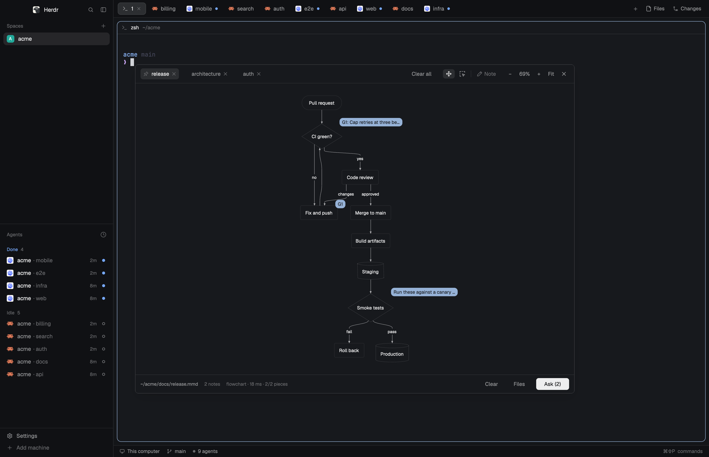
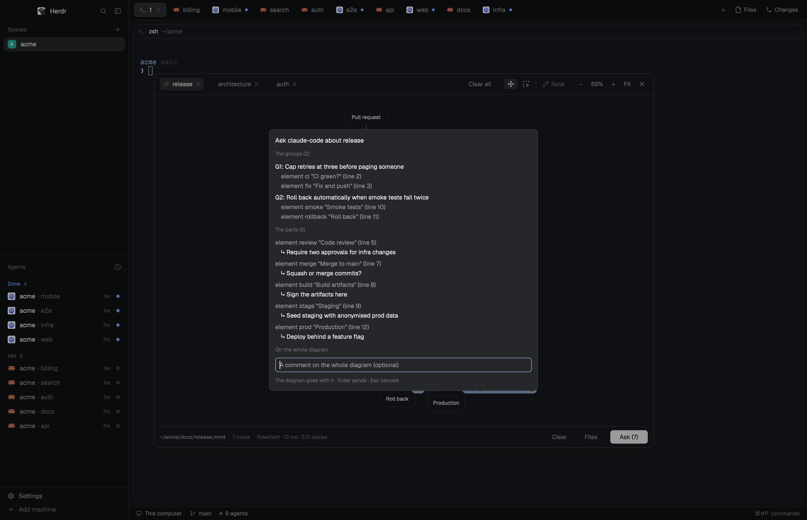

# herdr-scene

Diagrams drawn natively in [Herdr](https://herdr.dev) mods: an engine turns
its source into a renderer-neutral **scene** (paths, text, pickable items),
and one GPUI renderer draws any scene.



With notes on many parts and the Ask dialog that sends them to the agent:



```
Mermaid ─ pele fork (renderScene) ─┐
other SVG engines ─ svgToScene ────┼─▶ scene ─▶ SceneCanvas (GPUI, in a mod)
(next) math ─ MathJax adaptor ─────┘
```

- `src/scene.js` – the scene contract (version 2; pele's are version 6) and
  `SceneBuilder`.
- `src/svg.js` – adapter for other engines: SVG text → scene.
- `src/mermaid.js` – Mermaid → scene, drawn by the pele fork's `renderScene`
  for every diagram type. Items say where the author wrote them (line, name,
  a connection's ends) for the types the fork records it for.
- `src/batch.js`, `src/paint.js`, `src/viewport.js` – layering, theme colors,
  fit/zoom/hit testing. Colors resolve as on a page with pele's CSS: the
  Herdr theme sets the `--pele-*` variables, `<app home>/pele.css` sets them
  over it (per appearance under `@media (prefers-color-scheme: …)`), then a
  diagram file's own `<name>.pele.css` beside it, and a scene's `vars` say
  what its paints mean, a diagram's own palette included. Values may use
  `var()` (custom properties these files declare, else the theme's `--pele-*`),
  `hsl()`, `oklch()` and `color-mix()`.
  pele.css sets `--pele-radius`, the `--pele-*-weight` variables and
  `--pele-font`/`--pele-font-mono` the same way; unset, text is in Herdr's fonts.
- `src/gpui.js` – `SceneCanvas`, the Herdr renderer (pan, zoom, pick).
- `pele.json` pins the fork of [obsidianmd/pele](https://github.com/obsidianmd/pele),
  branch `scene-sink`.
- `mods/mermaid/` – Mermaid pane: `*.mmd` in
  `<app home>/data/mermaid/`, pick an item, Ask sends it with a request
  to the tab's agent.

## Develop

From this directory, run the following inside `nix develop`:

```sh
bash scripts/build.sh
node --test tests/*.test.mjs
node build/hscene.mjs check docs/mermaid.md
node build/hscene.mjs parts docs/mermaid.md --near canvas
```

`pele.json` pins the source that the development shell exports as `PELE_SRC`.
Outside the shell the script fetches that revision into
`${XDG_CACHE_HOME:-$HOME/.cache}/hmods/pele-<rev>` and uses esbuild 0.27.2
from PATH or npx. The build writes the Node bundles into `build/` and
refreshes the share's `mods/mermaid/vendor/`. Pass a directory
to `scripts/build.sh` to write the mod bundle elsewhere.

Commit regenerated vendor files with renderer changes. The Nix `vendor-fresh`
check compares every chunk against an independent build. To try the mod, run
`node build/hscene.mjs install --app-home DIR` for your chosen Herdr home.
